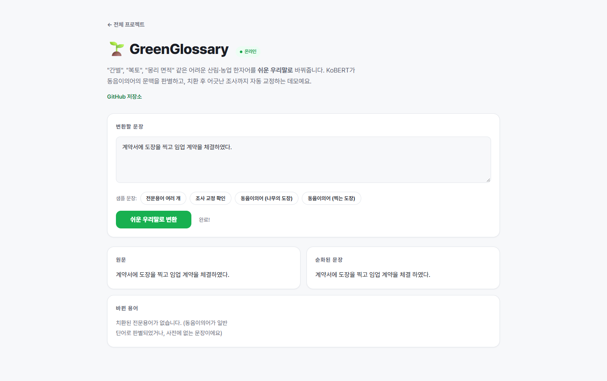
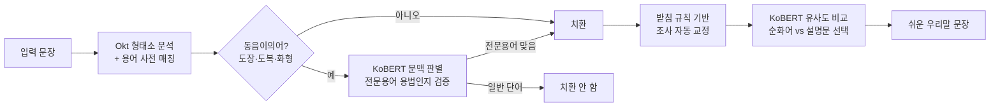

<div align="center">
  <h1>농림 전문용어 순화 번역기 (GreenGlossary)</h1>
  <h3>농림 전문용어를 쉬운 우리말로 바꾸는 번역 도구</h3>
  <p>어려운 산림·농업 한자어를 쉬운 우리말 문장으로 바꿉니다.</p>
  <p>
    <strong>팀</strong> 3인 팀 프로젝트<br />
    <strong>개발 기간</strong> 2022.09 ~ 2022.12<br />
    <strong>플랫폼</strong> 웹 (Flask 로컬 앱 · Gradio API + 커스텀 프론트엔드 라이브 데모)
  </p>
  <p><a href="https://demo-gateway.trealight112.workers.dev/greenglossary/">demo-gateway.trealight112.workers.dev/greenglossary</a></p>
</div>

---

## 📑 목차

- [서비스 소개](#service-introduction)
- [팀원 소개](#team)
- [주요 기능](#features)
- [기술 스택](#technology-stack)
- [시스템 아키텍처](#system-architecture)
- [ERD](#erd)
- [핵심 기술](#technology-details)
- [개발자 가이드](#getting-started)
- [디렉터리 구조](#directory-structure)
- [프로젝트 문서와 협업 규칙](#project-guide)

---

<a id="service-introduction"></a>

## 💡 서비스 소개

산림·농업 분야 문서에는 "간벌", "복토", "몽리 면적" 같은 한자어 전문용어가 많아 일반인이 읽기 어렵습니다. GreenGlossary는 **직접 구축한 전문용어 사전**과 **KoBERT 모델 4종**을 결합해, 이런 문장을 **쉬운 우리말로 자동 순화**합니다.

사전은 용어를 찾아 바꾸는 **치환 도구**이고, 품질을 결정하는 것은 **바꿔도 되는지(동음이의어 판별)** 와 **바꾼 뒤에도 뜻이 남는지(문장 유사도 검사)** 를 확인하는 검증 단계입니다.

전문용어를 쉬운 말로 1:1 치환하는 것만으로는 읽을 수 있는 문장이 나오지 않습니다. 같은 글자가 일상어로 쓰인 경우까지 바꿔 버리고, 바꾼 단어의 받침이 달라져 조사가 어색해지며, 짧은 순화어로는 원래 뜻이 빠지기도 합니다.
GreenGlossary는 이 세 가지를 **사전 매칭 + 문맥 판별 + 조사 교정 + 의미 검증**으로 나누어 풉니다.

* **한국어 전문용어 데이터셋이 없어 사전을 직접 구축** — 국립국어원 표준 전문용어 사전을 크롤링해 전문용어·순화어·설명문을 한 행으로 묶음
* **글자 일치가 아닌 문맥 판별** — "도장"(찍는 도장 / 나무의 도장지)처럼 일상어와 겹치는 용어는 전문용어 용법일 때만 치환
* **순화어와 설명문 두 가지 버전** — 짧은 순화어로 바꾼 문장의 뜻이 달라지면 더 설명적인 문장을 선택

---

<a id="team"></a>

## 👥 팀원 소개

<div align="center">
<table align="center">
  <tr>
    <td align="center"><strong>김진광</strong><br />아이디어 구상·문제 정의 · 용어 사전 구축·키워드 추출 · 역번역 시스템 구축 · NLP 모델링</td>
  </tr>
</table>
</div>

(상명대학교 캡스톤 디자인) · 2026.08 라이브 데모 리팩터링

---

<a id="features"></a>

## ✨ 주요 기능

<table width="100%">
  <thead>
    <tr><th width="56%">화면</th><th width="44%">설명</th></tr>
  </thead>
  <tbody>
    <tr>
      <td width="56%"><a href="docs/images/screenshots/01-result.png"></a></td>
      <td width="44%" valign="middle"><strong>전문용어 순화</strong><br /><br />문장 속 전문용어를 쉬운 말로 바꾸고 바뀐 용어를 함께 표시</td>
    </tr>
    <tr>
      <td width="56%"><a href="docs/images/screenshots/02-homonym.png"></a></td>
      <td width="44%" valign="middle"><strong>동음이의어 판별</strong><br /><br />문맥상 전문용어가 아닌 낱말은 바꾸지 않고 그대로 둠</td>
    </tr>
  </tbody>
</table>

### 기능 목록

| 기능 | 설명 |
|---|---|
| 🔍 **전문용어 사전 매칭** | Okt 형태소 분석 후 용어 사전과 대조해, 문장 번호·토큰 위치 단위로 치환 대상을 기록 |
| 🧠 **동음이의어 문맥 판별** | 도장·도복·화형 3개 용어는 용어별 KoBERT 분류 모델이 문장 문맥을 보고 전문용어 용법일 때만 치환 |
| ✏️ **조사 자동 교정** | 치환 후 받침이 달라지면 뒤따르는 조사(을/를, 이/가, 은/는, 과/와, 으로/로 등)를 맞춤 (예: "간벌**을**" → "솎아베기**를**") |
| ⚖️ **의미 보존 문장 선택** | 순화어 버전과 설명문 버전을 KoBERT 문장 유사도로 비교해, 유사도 0.9 이하이면 설명문 버전 채택 |
| 🏷️ **치환 내역 반환** | 라이브 데모 API는 용어·순화어·설명·동음이의어 판별 여부를 구조화해 반환하고, 프론트엔드가 하이라이트와 카드로 표시 |

---

<a id="technology-stack"></a>

## 🛠️ 기술 스택

| 영역 | 스택 |
|---|---|
| **NLP** |   KoBERT (문장 유사도 · 이진 분류, tensorflow-text) + KoNLPy Okt (형태소 분석) |
| **백엔드** |   |
| **데이터** |  openpyxl (엑셀 기반 용어 사전) · BeautifulSoup (사전 크롤링) |
| **인프라** |    |
| **원래 구현 (2022)** | Papago API 한-일-한 역번역 (서비스 종료로 2026 리뉴얼에서 규칙 기반 교정으로 대체) |

---

<a id="system-architecture"></a>

## 🏗️ 시스템 아키텍처

### 서비스 구성

모든 용어를 모델로 번역하지 않고, **사전이 치환을 맡고 KoBERT는 치환의 앞뒤를 검증**하는 구조로 나눴습니다.



**요청 흐름 (문장 입력 → 순화 문장)**

1. 입력 텍스트를 문장 단위로 나누고 Okt로 형태소 분석한 뒤, 토큰을 용어 사전과 대조해 위치를 기록
2. 동음이의어 후보(도장·도복·화형)는 해당 용어의 KoBERT 분류 모델에 문장을 넣어, 예측값 0.8 이상일 때만 치환 대상으로 확정
3. 같은 문장을 **순화어 버전**과 **설명문 버전** 두 가지로 치환하고, 치환한 단어 바로 뒤의 조사를 받침 규칙으로 교정
4. 두 버전의 KoBERT 문장 유사도가 0.9 이하이면 설명문 버전을, 아니면 순화어 버전을 선택
5. 문장을 다시 이어 붙여 결과를 반환 (라이브 데모 API는 치환 내역도 함께 반환)

> 동음이의어 판별 모델은 용어마다 따로 학습해야 하므로, 사전 전체가 아니라 일상어와 실제로 겹치는 3개 용어에만 모델을 붙이고 나머지는 사전 치환으로 처리했습니다.

#### 🌐 라이브 데모 아키텍처

```text
[커스텀 프론트엔드]                        [백엔드 API]                       [모델 저장소]
Cloudflare                          ──▶ HF Space: kimjgwang/ml-demos  ──▶ HF Model: greenglossary-kobert
demo-gateway/greenglossary/             /simplify API (Py 3.11·TF 2.15)    KoBERT SavedModel 4종 (1.3GB)
문장 입력·용어 하이라이트/카드            Cafe-Focusing과 통합 호스팅          기동 시 snapshot_download
```

* HF 무료 티어 제약(ZeroGPU Space 2개, Space 저장소 1GB)에 맞춰 **백엔드는 통합 Space**([kimjgwang/ml-demos](https://huggingface.co/spaces/kimjgwang/ml-demos))에서, **모델은 별도 Model 저장소**([kimjgwang/greenglossary-kobert](https://huggingface.co/kimjgwang/greenglossary-kobert))에서 제공
* KoNLPy(Okt)의 JVM 의존성은 HF `packages.txt`(default-jre)로 해결
* 추론은 CPU에서 실행해 방문자별 ZeroGPU 쿼터를 쓰지 않음

#### ♻️ 2026 리뉴얼 (라이브 데모 개편)

| 분류 | 원래 구현 (2022 캡스톤) | 리팩터링 후 (2026.08) |
|---|---|---|
| **조사 교정** | Papago API 한-일-한 역번역 | API 서비스 종료로 동작 불가 → 형태소 태그 기반 **결정론적 조사 교정 규칙**으로 대체 (외부 API 의존 제거, 항상 동작, 즉시 응답) |
| **서버 구조** | Flask 단일 앱 | **Gradio API 서버(`demo_api.py`) + 커스텀 프론트엔드** 2-티어 구조. Flask 앱(`app.py` + `server.py`)은 로컬 실행용으로 유지 |
| **응답 형식** | 순화된 문장만 화면에 표시 | 치환 내역(용어/순화어/설명/동음이의어 판별 여부)을 구조화해 반환 — 프론트에서 하이라이트 표시 |
| **모델 배포** | gdown(구글 드라이브) 다운로드 | 링크 만료·쿼터 문제로 **Hugging Face Hub**(`download_models.py`)로 교체 |
| **정리** | — | 미사용 파일 제거(구 번역기, 템플릿 README, 무관한 이미지), eager import 정리, 하드코딩됐던 API 키는 이전에 폐기·제거 완료 |

---

<a id="erd"></a>

## 🗄️ ERD

용어 사전은 Excel로 관리하며, 순화 과정에서는 이를 메모리에 읽어 사용합니다. 관계형 데이터베이스를 사용하지 않습니다.

---

<a id="technology-details"></a>

## 🔬 핵심 기술

<a id="-순화-파이프라인-4단계"></a>

### 🔬 순화 파이프라인 4단계

각 단계는 `src/nlp_processor.py`의 함수 하나에 대응하고, 모델이 없어도 1·3단계(사전 매칭·조사 교정)는 그대로 동작합니다.

| 단계 | 역할 | 방법 |
|---|---|---|
| **1. 사전 매칭** | 문장에서 전문용어와 위치 찾기 | Okt 형태소 분석 결과를 용어 사전(전문용어 → 순화어·설명문)과 대조. 매칭 결과는 요청마다 새로 만들어 요청 간 상태가 섞이지 않게 함 |
| **2. 동음이의어 판별** | 일상어로 쓰인 경우 치환 제외 | 도장·도복·화형 용어별 KoBERT 이진 분류 모델. 예측값 0.8 이상이면 전문용어 용법으로 판정 |
| **3. 치환 + 조사 교정** | 순화어·설명문 두 버전 생성 | 토큰을 교체한 뒤, 바로 뒤 토큰이 조사면 마지막 어절의 받침(으로/로는 ㄹ 받침까지)에 맞춰 교정 |
| **4. 문장 선택** | 뜻이 훼손된 치환 걸러내기 | 두 버전의 KoBERT 문장 임베딩 유사도를 계산해 0.9 이하이면 설명문 버전, 초과이면 순화어 버전 채택 |

<a id="-데이터-규모와-실측"></a>

### 📊 데이터 규모와 실측

| 단계 | 결과 |
|---|---|
| **용어 사전 구축** | 국립국어원 표준 전문용어 사전 크롤링으로 전문용어-대체어 매핑 **951개** 구축 |
| **저장소 포함 사전** | `data/agriculture_dictionary.xlsx` — 810행, 고유 전문용어 **801개** (전문용어 · 순화어 · 설명문 3열) |
| **동음이의어 판별** | KoBERT 파인튜닝으로 판별 정확도 **99.0%** (기존 약 30.8 → 99.0) |
| **실문서 변환 테스트** | 농업 뉴스 100건 중 **93건** 자연스러운 변환 |
| **모델** | KoBERT SavedModel **4종 · 약 1.3GB** (문장 유사도 1종 + 동음이의어 판별 3종) |

<a id="-트러블-슈팅"></a>

### 💥 트러블 슈팅

#### 1. 용어 사전 직접 구축
* **현상:** 농·임업 전문용어와 쉬운 대체어를 짝지은 공개 데이터셋이 없음.
* **해결:** 국립국어원 표준 전문용어 사전을 크롤링해 매핑 사전 951개 구축.

#### 2. 동음이의어 오변환 해결
* **현상:** "도복", "도장"처럼 뜻이 여러 개인 단어가 전문용어가 아닌 문장에서도 치환.
* **원인:** 사전 매칭은 글자만 보고 문맥을 보지 않음.
* **해결:** 용어별로 KoBERT를 파인튜닝해 문맥으로 판별, 판별 정확도 **99.0%**.

#### 3. 조사 교정
* **현상:** 치환한 단어의 받침이 달라 "솎아베기을"처럼 조사가 어긋남.
* **해결 (원래 구현):** Papago API 한-일-한 역번역으로 교정.
* **해결 (2026 리뉴얼):** API 서비스 종료로 받침 유무에 따라 조사를 고르는 규칙으로 대체.

#### 4. 의미 손실 방지
* **현상:** 순화어 한 단어로 바꾸면 원래 뜻이 일부 사라지는 문장 발생.
* **해결:** 순화어 버전과 설명문 버전을 모두 만들고 문장 유사도가 0.9 이하이면 설명문 버전 채택.

#### 5. 추론 환경 문제 해결
* **현상:** Windows에서 KoBERT 모델을 불러올 수 없음.
* **원인:** `tensorflow-text`가 Windows용 설치 파일을 제공하지 않음.
* **해결:** Python 3.11 + TensorFlow 2.15를 담은 Linux 도커 이미지로 실행.

#### 6. 요청 간 상태 오염 수정
* **현상:** 앞선 요청의 용어 위치가 다음 요청 결과에 누적.
* **원인:** 매칭 위치를 공유 사전 객체에 직접 기록.
* **해결:** 공유 사전은 읽기만 하고 매칭 결과는 요청마다 새 객체로 생성.

---

<a id="getting-started"></a>

## 🚀 개발자 가이드

<details>
<summary><strong>소스에서 실행하고 테스트하기</strong></summary>

**요구 사항:** Docker (권장) 또는 Linux + Python 3.11 + JRE (KoNLPy Okt용)

```bash
docker build -t greenglossary .
docker run -p 5000:5000 greenglossary   # Flask 웹앱 http://localhost:5000
```

KoBERT 모델(약 1.3GB)은 컨테이너 기동 시 HF 모델 저장소에서 자동으로 내려받습니다.

Linux에서 직접 실행할 때:

```bash
pip install -r requirements.txt   # tensorflow-text는 Windows 미지원
python download_models.py         # KoBERT 모델 다운로드 (약 1.3GB, HF Hub)
python demo_api.py                # Gradio API/UI http://localhost:7860
python server.py                  # 또는 Flask 웹앱 http://localhost:5000
```

Windows에서 직접 실행하면 `tensorflow-text` 휠이 없어 모델 추론이 불가하므로 도커 방식을 사용합니다. 사전 매칭·조사 교정 로직은 모델 없이도 동작합니다 (`konlpy`, `pandas`, `openpyxl`만 설치).

</details>

---

<a id="directory-structure"></a>

## 📁 디렉터리 구조

<details>
<summary><strong>주요 디렉터리 보기</strong></summary>

```text
GreenGlossary/
├── demo_api.py             # 라이브 데모용 Gradio API 서버 (HF Spaces 진입점)
├── app.py / server.py      # Flask 웹앱 (로컬 실행용)
├── config.py               # 모델 · 데이터 경로 설정
├── download_models.py      # KoBERT 모델 다운로드 스크립트 (HF Hub)
├── Dockerfile              # 도커 이미지 (py3.11 + TF 2.15 + JRE, 모델 자동 다운로드)
├── requirements.txt        # 의존성 (TF 2.15 고정 — SavedModel 호환)
├── packages.txt            # HF Spaces 시스템 패키지 (JVM)
├── data/
│   └── agriculture_dictionary.xlsx  # 전문용어 사전 (전문용어 · 순화어 · 설명문)
├── src/
│   ├── dictionary.py       # 용어 사전 로더
│   ├── models.py           # KoBERT 모델 매니저 (유사도 · 동음이의어)
│   └── nlp_processor.py    # 매칭 · 치환 · 조사 교정 · 문장 선택 파이프라인
├── templates/              # Flask 화면 (home.html · after.html · css/)
└── model/                  # KoBERT 모델 4종 (git 미추적 — download_models.py로 다운로드)
```

</details>

---

<a id="project-guide"></a>

## 📚 프로젝트 문서와 협업 규칙

<details>
<summary><strong>문서와 협업 규칙 보기</strong></summary>

<a id="데이터-출처"></a>

### 데이터 출처

- 국립국어원 표준 전문용어 사전 — 전문용어·순화어·설명문 수집 원천

[소스 코드](src/) · [사전과 예제 데이터](data/) · [프로젝트 문서](docs/)

</details>
